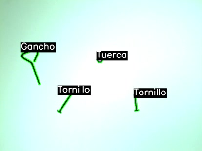
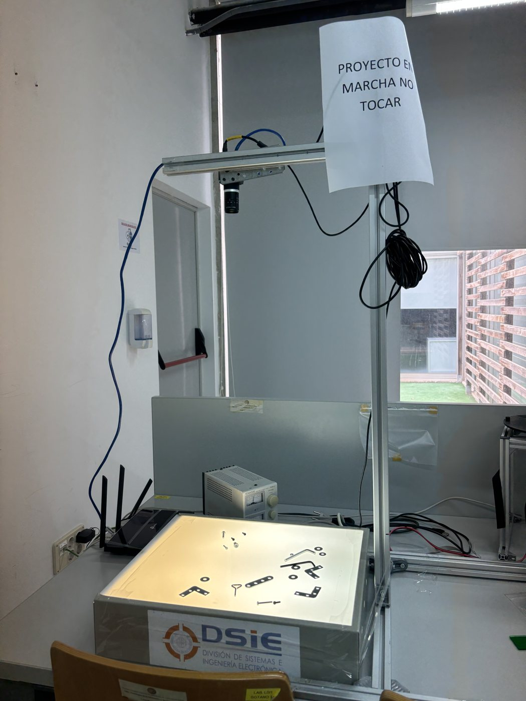
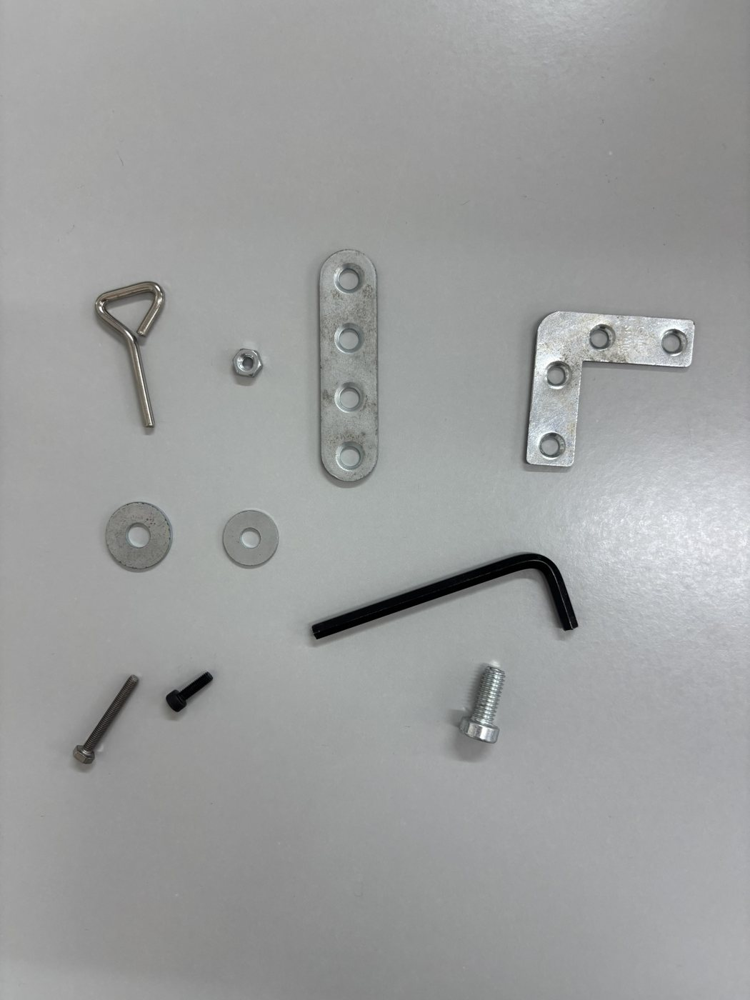
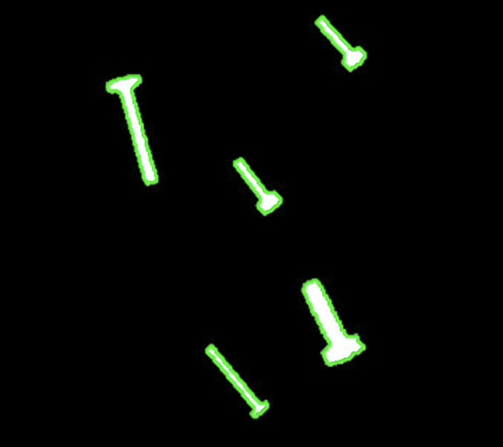
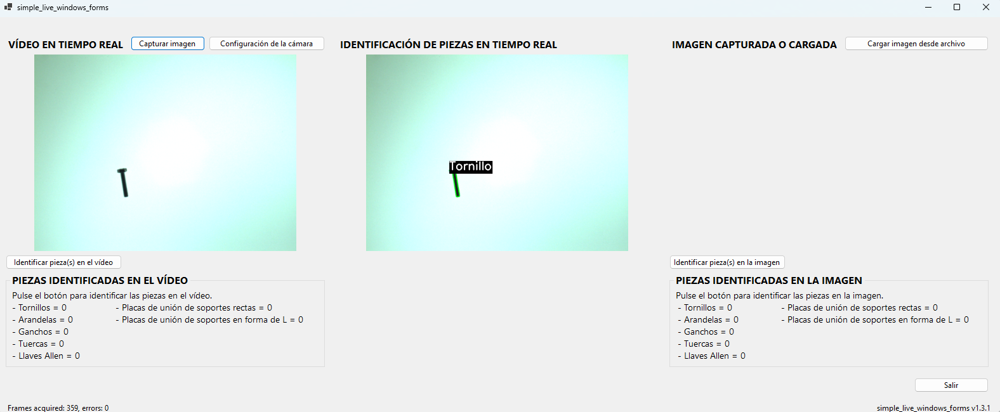

# Machine vision part inspection

A C# desktop application that inspects small mechanical parts with an industrial camera: it captures live video, separates each part from the background and classifies it automatically.

Final project for the **Programming Languages** course (4th year of the Bachelor's Degree in Industrial Technology Engineering, Technical University of Cartagena, 2024-25).

## What it does

- Shows the live camera feed and, side by side, the same feed with each part outlined and labelled.
- Captures a frame or loads an image from disk and analyses it.
- Counts how many parts of each type are in the video or the image.
- Adjusts the camera's exposure, gain and frame rate from a settings window.

It recognises seven types of part: screws, nuts, washers, Allen keys, hooks, and straight and L-shaped joining plates.

The user interface and the part labels are in Spanish.

| Setup | Parts |
|---|---|
|  |  |

## How it works

**Hardware.** IDS UI-6230SE-C industrial camera (GigE, 1024 × 768 px CCD sensor) with a 16 mm C-mount lens. The parts sit on a backlight panel, so each part appears as a dark silhouette on a bright background, which makes segmentation much easier.

**Image processing** with Emgu CV (OpenCV for .NET):

1. Convert the frame to greyscale and binarise it with a threshold.
2. Detect contours with `CvInvoke.FindContours` and use the contour hierarchy to tell outer contours (parts) from inner ones (holes).
3. Compute features for each part: number of holes, area, perimeter, aspect ratio, circularity, solidity, number of vertices of the approximated polygon and convexity.

**Rule-based classification** from those features (areas in pixels²):

| Part | Rule |
|---|---|
| Washer | 1 hole, circularity > 0.75, aspect ratio between 0.75 and 1.25, more than 7 vertices |
| Nut | 1 hole, between 5 and 7 vertices |
| L-shaped joining plate | More than 1 hole, not convex, area > 14,000 |
| Straight joining plate | More than 1 hole, convex, area > 14,000 |
| Screw | Area < 3,000, circularity < 0.5 |
| Allen key | No holes, not convex, area > 5,000, solidity < 0.25 |
| Hook | No holes, not convex, area between 3,000 and 5,000, more than 7 vertices |

A part that matches none of the rules is labelled as unknown.

This is classic computer vision, not machine learning. The thresholds were tuned by hand for this setup (distance, lens and lighting), so a different setup would need them recalibrated.

## Interface

## Tech stack

- C# and .NET 6 (Windows Forms)
- Emgu CV 4.5.5 (OpenCV wrapper for .NET)
- IDS peak SDK for camera communication

## Requirements

- Windows with Visual Studio 2022 and the ".NET desktop development" workload (.NET 6).
- **IDS peak SDK** installed. The project loads the camera libraries from the `IDS_PEAK_GENERIC_SDK_PATH` environment variable, which the SDK installer creates. These libraries are not included in this repository.
- The Emgu CV packages are restored automatically from NuGet on build.
- A compatible IDS camera connected, for the live video.

## Build and run

1. Open `simple_live_windows_forms_csharp_VCS.sln` in Visual Studio.
2. Select the **x64** (or x86) platform. The project does not support Any CPU.
3. Build and run.

## Project structure

| File | Contents |
|---|---|
| `Program.cs` | Application entry point |
| `BackEnd.cs` | Camera communication: opening, acquisition, and exposure, gain and frame rate settings |
| `AcquisitionWorker.cs` | Acquisition thread that receives frames from the camera |
| `FormWindow.cs` | Main window, image processing and part classification |
| `CameraSettingsForm.cs` | Camera settings window |
| `SimplePictureBox.cs` | Thread-safe image control |
| `docs/` | Project report (in Spanish), UML diagrams and images |

## Possible improvements

- Save frames with the contours and labels drawn on them.
- Add more camera parameters to the settings window, plus a button to restore the defaults.
- Separate overlapping parts, for example with the watershed algorithm.

## Credits

The application is built on the `simple_live_windows_forms` sample that IDS Imaging Development Systems GmbH ships with its SDK. The files that come from that sample keep their original copyright header, which allows copying and modification. The segmentation, the part classification, the inspection interface and the camera settings window are my own work.

Author: Victoria Carbonell Sánchez · [Interactive CV](https://victoriacarbonell.github.io) · [LinkedIn](https://www.linkedin.com/in/victoriacarbonellsanchez/)
